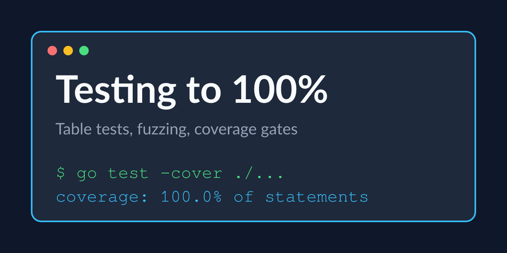

# Testing to 100%

Table tests, fuzzing and a coverage gate that cannot be fooled.

Tested Go code for the third course of the Go specialization: table-driven tests, subtests, a fuzz target, fakes, and a 100% gate with a 0% falsifier.

## Examples

| example | what it does |
|---|---|
| [`examples/tests`](examples/tests) | table tests, a fuzz target and a fake store, all at 100% |

## Prerequisites

- Go 1.21 or newer
- Course 1: Go from Zero

---

Generated — do not edit by hand. Edit `course.toml` and re-render.
